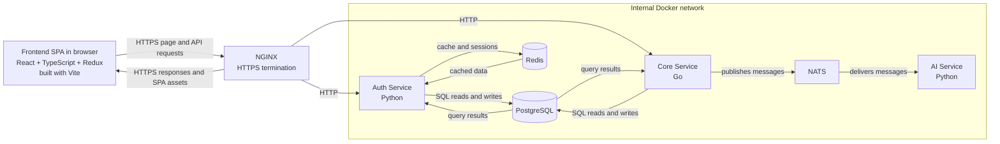

# System architecture

This diagram describes the intended architecture.

## Request and data flow

1. NGINX serves the frontend and terminates HTTPS connections from the browser.
2. Frontend API requests pass through NGINX, which forwards them to Auth Service or Core Service over HTTP on the internal network.
3. Auth Service, implemented in Python, uses PostgreSQL and Redis.
4. Core Service, implemented in Go, uses PostgreSQL and publishes work/messages to NATS.
5. AI Service, implemented in Python, receives messages from NATS.

PostgreSQL is shared infrastructure, but each service should access data through its own domain and schema. Browser clients should not connect directly to backend services or infrastructure.

## Current scaffold status

The diagram represents the target design, not the current implementation in every detail. In this checkout, `backend/core/` is still a Python/FastAPI placeholder, the compose health check and Docker configuration for Core are Python-oriented, and the frontend package manifest does not currently list Redux. Align those implementation details with the target architecture when implementing the services.
